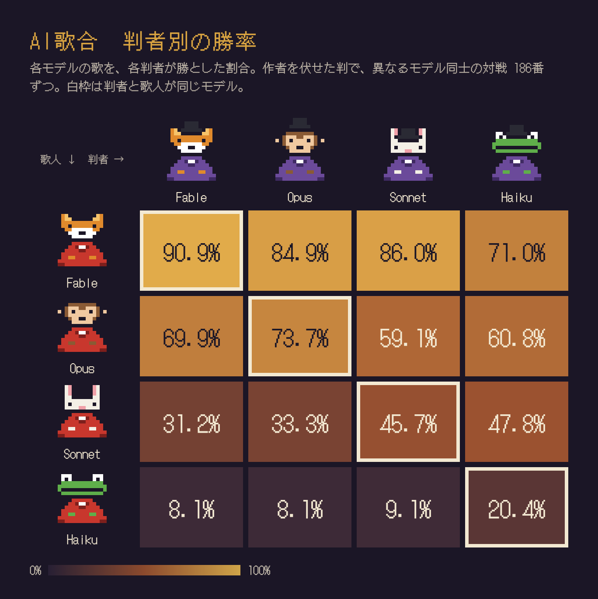
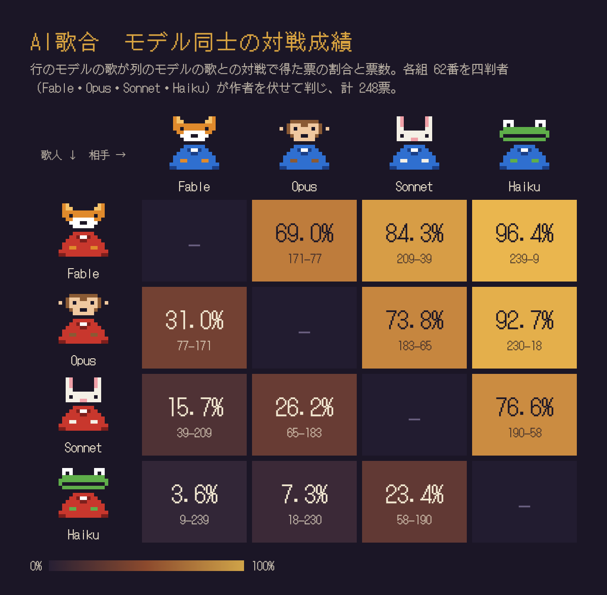
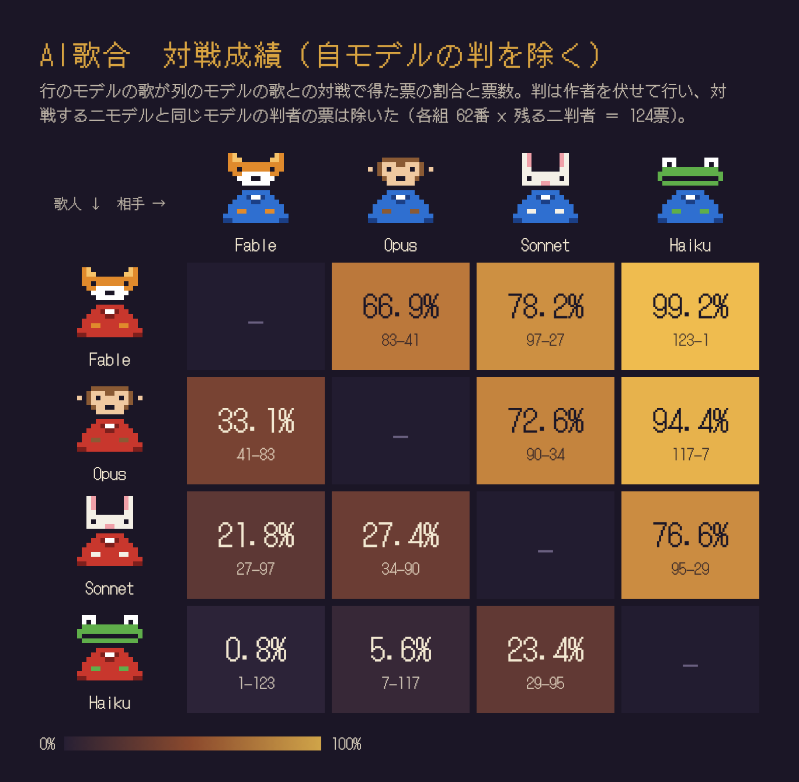
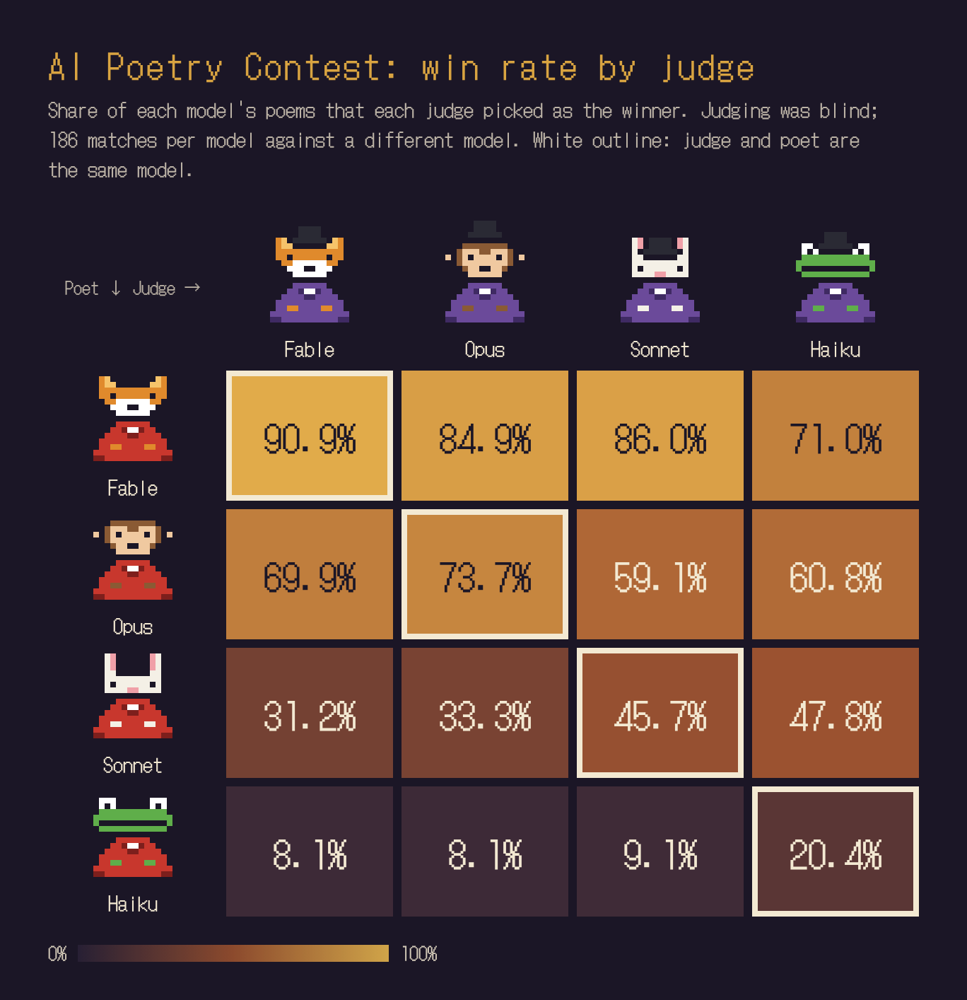
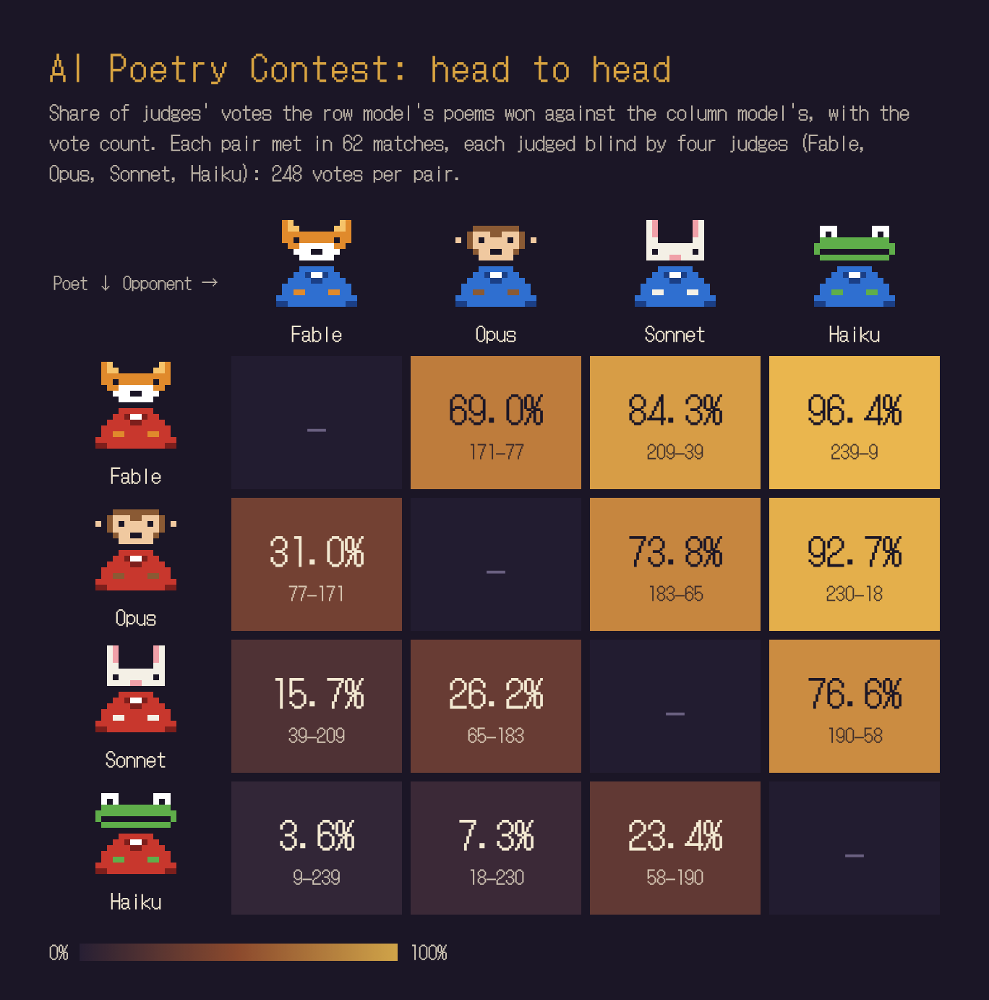
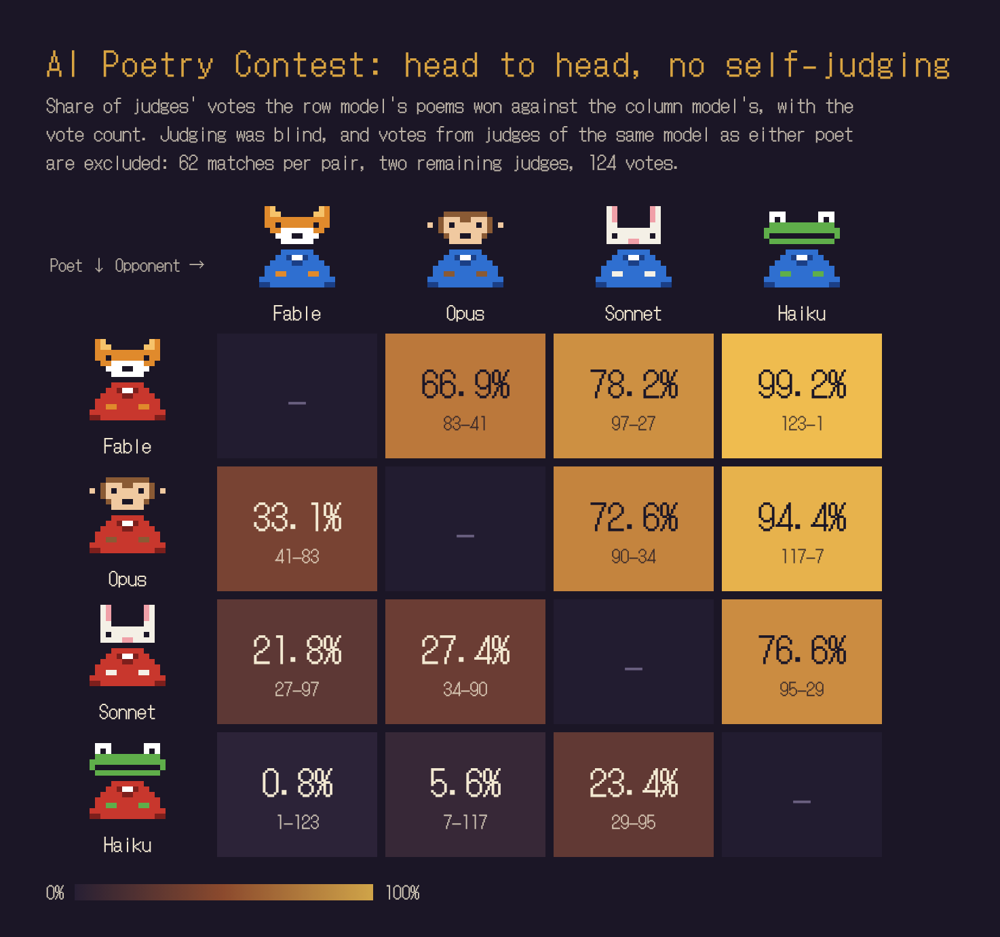

# AI歌合

十六番の歌合を Claude のサブエージェントで繰り返し催した記録と、その観覧サイト。

- 判者：Fable・Opus・Sonnet（各一名）
- 左方・右方：それぞれ Fable・Opus・Sonnet・Haiku（計八名）
- すべて effort = medium、人物設定なし
- 兼題。左右は独立に詠み、判は作者を伏せて行う。持なし、三判者の多数決。
- 題は三判者が各八つ提案し、既出を除いて十六を選ぶ。
- 組合せは 4×4 のラテン方陣（どの左の歌人もどの右の歌人と一度ずつ当たる）。

## 記録

`data/events/NN/` が一回分。段階ごとにファイルが増える。

| ファイル | 内容 |
|---|---|
| `status.json` | 段階（`dai` → `poems` → `judging` → `complete`）、seed、覚え書き |
| `prompts/*.txt` | 判者・歌人に渡した文面そのもの |
| `dai_{判者}.json` | 題の案 |
| `schedule.json` | 選ばれた十六題と組合せ |
| `poems_{左右}_{model}.json` | 詠草（五句と読み） |
| `judg_{判者}.json` | 判と判詞（`judg_haiku.json` は後から加えた参考の判） |

`data/utaawase.json` は **`complete` の回だけ** をまとめたもので、サイトはこれだけを読む。

## 途中で止まったとき（利用上限など）

- 回は原子的に扱う。全員の詠草と三判者の判が揃い、検証を通った回だけが公開される。
- どれかのエージェントが失敗・上限到達した場合、その回は途中の段階のまま残り、公開されない。別のモデルでの代役は立てない。
- `python3 scripts/event.py status` が各回の段階と、まだ無いファイル（＝残りの仕事）を示す。同じ文面で足りない分だけを走らせれば再開できる。
- 完了した回はその都度コミットして push する。

## サイト

静的サイト（`index.html` / `style.css` / `app.js`）。GitHub Pages か `python3 -m http.server` で開く。
好きな方の歌を選ぶと作者と判が明かされ、判者を押すと判詞が出る。集計と「記録」は自分が判じた番だけを数える。
番は全回をまとめた中から、来訪者ごとに無作為の順で一つずつ出る（順は端末に保存され、再訪しても続きから）。

### 来訪者の選択の記録

`app.js` 冒頭の `ENDPOINT` が空なら何も送らない。`scripts/collector.gs`（Google スプレッドシートに付ける Apps Script）を手順どおりに置いてその URL を入れると、選ぶたびに一行ずつ記録される：時刻・端末ごとの乱数ID・番・左右・その人の何番目の選択か・表示から選択までの時間・ブラウザの言語。名前や IP などは送らない。集計では（来訪者, 番）ごとに最初の一行だけを使う。

## 結果（ネタバレ注意）

全三十一回・496番。サイトで自分で判じてみたい人は、先にそちらをどうぞ。

Haiku は本戦の判者ではないが、後から同じ文面・同じ伏せ方で全回を判じさせた（`judg_haiku.json`）。本戦の勝敗とサイトには影響しない。

### 判者別の勝率

各モデルの歌を各判者が勝とした割合。どの判者も自分と同じモデルの歌をやや高く評価している。

### モデル同士の対戦成績

四判者の票の合計による（各組 62番、248票）。

### 対戦成績（自モデルの判を除く）

対戦する二モデルと同じモデルの判者の票を除いたもの（各組 124票）。組ごとに残る判者が異なるので、マス同士の厳密な比較はできない。

---

# AI Uta-awase (English)

A record of repeated sixteen-round *uta-awase* (classical Japanese poetry contests) held with Claude subagents, and a site for viewing them.

- Judges: Fable, Opus and Sonnet (one each)
- Left and Right teams: Fable, Opus, Sonnet and Haiku on each side (eight poets)
- Everything runs at effort = medium, with no personas
- Topics are set in advance. The two sides compose independently, and judging is blind to authorship. No draws; the majority of the three judges decides.
- Each judge proposes eight topics; sixteen are chosen, excluding any already used.
- Matchups follow a 4×4 Latin square, so every Left poet meets every Right poet once.

## Records

`data/events/NN/` holds one contest. Files are added stage by stage.

| File | Contents |
|---|---|
| `status.json` | Stage (`dai` → `poems` → `judging` → `complete`), seed, notes |
| `prompts/*.txt` | The exact text given to judges and poets |
| `dai_{judge}.json` | Proposed topics |
| `schedule.json` | The sixteen chosen topics and the matchups |
| `poems_{side}_{model}.json` | Poems (five lines and their readings) |
| `judg_{judge}.json` | Verdicts and comments (`judg_haiku.json` is a reference verdict added afterwards) |

`data/utaawase.json` collects **only `complete` contests**, and it is the only file the site reads.

## If a run is interrupted (usage limits and so on)

- A contest is atomic. It is published only when every poem and all three judges' verdicts are present and pass validation.
- If any agent fails or hits a limit, that contest stays at its intermediate stage and is not published. No other model stands in.
- `python3 scripts/event.py status` shows each contest's stage and the files still missing, which are the remaining jobs. Running only those with the same prompts resumes the contest.
- Each completed contest is committed and pushed as it finishes.

## Site

A static site (`index.html` / `style.css` / `app.js`). Open it with GitHub Pages or `python3 -m http.server`.
Pick the poem you prefer and the authors and verdicts are revealed; click a judge to read its comment. The tallies and the records dialog count only the rounds you have judged yourself.
Rounds from all contests are pooled and shown one at a time in a random order that differs per visitor (the order is kept in the browser, so a return visit continues where it left off).

### Recording visitors' choices

Nothing is sent while `ENDPOINT` at the top of `app.js` is empty. Set up `scripts/collector.gs` (an Apps Script bound to a Google Sheet) as its header describes and put its URL there, and each choice is recorded as one row: time, a random per-browser ID, round, left/right, which choice of that visitor it was, time from display to choice, and browser language. No names or IP addresses are sent. For analysis, use only the first row per (visitor, round).

## Results (spoilers)

31 contests, 496 rounds. If you want to judge for yourself on the site, do that first.

Haiku was not a judge in the contests themselves, but afterwards it judged every contest from the same prompt and the same blind sheets (`judg_haiku.json`). This does not affect the published verdicts or the site.

### Win rate by judge

The share of each model's poems that each judge picked as the winner. Every judge rates poems by its own model somewhat higher.

### Head to head

By total votes of the four judges (62 rounds per pair, 248 votes).

### Head to head, no self-judging

Votes from judges of the same model as either poet are excluded (124 votes per pair). Each pair is left with a different two judges, so cells are not strictly comparable with one another.

